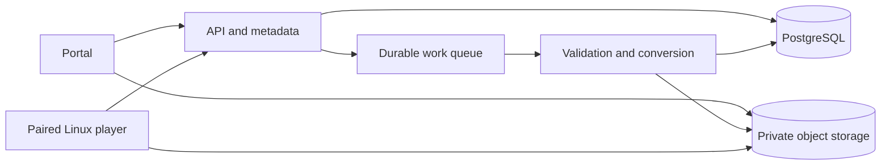

Brief A — Assets, Playlists, Schedules and Screens

# Proposed team delivery plan

Status: proposed design and estimate, prepared 2026-10-30. Product-trial observations and the candidate's scope/estimate review remain required before submission. This document proposes a new implementation; it does not describe OptiSigns' internal architecture.

## Outcome and delivery assumptions

A customer uploads a file, builds an ordered playlist, schedules it, pairs a Linux player and sees the intended content play. The same customer can organize and maintain the associated files, playlists, schedules and screens without breaking content already playing.

Plan for two full-time fullstack engineers, one QA engineer at 0.4 FTE and four designer-days concentrated around discovery and the first user flow. An engineering day is eight hours of effort, not one elapsed calendar day. Assume 80% of engineering capacity is available for planned delivery after coordination and support: two engineers provide eight planned engineering-days per week.

Baseline effort is 48 engineering-days, with 12 additional days of contingency: 60 days total, approximately 7.5 weeks at the assumed capacity. Plan an eight-week delivery window, including rollout. Separately budget 16 QA-days and four designer-days; do not add them to engineering effort or assume they substitute for engineering capacity. These are proposed implementation estimates, distinct from the take-home's ten-hour planning budget. Re-estimate after the initial playback and conversion spikes.

Initial capacity assumption: one region, up to 100 customer workspaces, 1,000 paired players and 10,000 uploaded files. This bounds testing and infrastructure sizing; it is not a measured demand forecast. The customer must validate it before committing to a production target.

## Product evidence and decisions still requiring observation

Documentation reviewed supports the following behavior:

- The [asset guide](https://support.optisigns.com/hc/en-us/articles/360016247974) describes uploading, searching, previewing, downloading, duplicating, replacing and deleting uploaded files.
- The [playlist guide](https://support.optisigns.com/hc/en-us/articles/28295104605843) describes ordered content and editable item durations. This slice limits content to uploaded files even though the product supports more content types.
- The [pairing guide](https://support.optisigns.com/hc/en-us/articles/360016374813) describes entering a player-displayed pairing code in the portal. The [assignment guide](https://support.optisigns.com/hc/en-us/articles/360016375153) describes selecting an asset, playlist or schedule for a screen.
- The [schedule guide](https://support.optisigns.com/hc/en-us/articles/360016981853) describes recurrence, screen-local time zones, one-time-event precedence, updated recurring-event precedence and fallback content.

These are Help Center findings, not claims of having used the live product. Before finalizing, record the trial version/plan, exact actions and outcomes in [product observations](scio-product-observations.md). In particular, verify replacement propagation, deletion of referenced files, document-page durations, folder behavior, schedule conflicts, default settings and device playback. Do not turn an untested assumption into a description of current SCIO behavior.

## Scope

**Assets:** uploaded images, videos and documents; search, preview, download, duplicate, replace and delete; hierarchical folders; file settings and plan-dependent size/storage enforcement. Initially support JPEG/PNG, MP4 with a defined H.264/AAC profile, PDF and PPTX converted to static pages. The file picker accepts local files and files downloaded from other storage providers. Add a bounded HTTPS import path for approved source hosts; native Google Drive/Dropbox/OneDrive account integrations are deferred. Report unsupported formats explicitly rather than silently failing.

**Playlists:** ordered uploaded-file references, per-item duration, looping, naming, folders, orientation/fit and a default image/document duration. Video duration can default to its detected length. Page-based documents have an explicit per-page duration setting. Nested playlists, transitions and item-specific scheduling are later increments; study their current product behavior for the interview.

**Schedules:** calendar events targeting one uploaded file or playlist, start/end times, one-off and weekly recurrence, folders, screen-local timezone evaluation, conflict warnings and configurable fallback content. Defer arbitrary monthly/custom recurrence rules, exceptions and temporary takeover to a later phase. State these cuts explicitly in the handoff.

**Screens:** expiring pairing code, name, folder, direct asset/playlist/schedule assignment, timezone, orientation/fit, fallback selection, online/last-seen status, unpairing and one Linux Chromium kiosk player. Include real playback on the paired device. Android/Fire TV/iOS/Windows-native apps, remote OS management and fleet software updates are excluded from this first release.

Integrate a managed identity provider for portal sign-in and enforce workspace boundaries in every server operation. This assumes a third-party identity product, not an existing SCIO backend: the selected slice is still built from scratch. This is the minimum security foundation for Brief A, not a separate custom-role/folder-sharing project from Brief B. Billing, app content, web pages, templates, social feeds and complex multi-zone screen layouts are excluded.

## Architecture and ownership

Use a React/TypeScript portal, a Python HTTP API and worker, PostgreSQL for transactional metadata, and private object storage for originals and renderable derivatives. Start with one deployable backend plus a separate worker process, not a microservice estate. Pin supported dependency versions when implementation starts.

The API owns workspace authorization, quotas, metadata, pairing and publishing. The worker owns file validation, scanning, video inspection, thumbnail generation and document conversion. The Linux player owns downloading a published manifest, local schedule evaluation, caching, playback and heartbeat reporting. Use a durable queue or transactional outbox so asset readiness and publication messages can be retried after worker failure.

### Core model

- `Workspace`, `Membership`, `PlanLimits`: ownership, authenticated access, upload/storage/screen limits. Quota reservations prevent concurrent uploads from exceeding limits.
- `Folder`: workspace, resource kind, parent, name. Prevent cycles and cross-workspace moves. Sharing and role customization are deferred.
- `Asset`: stable identity, folder and user-facing settings. `AssetVersion` records immutable source checksum, size, detected type, readiness and derivatives. References use the stable asset identity; replacing bytes creates a version.
- `Playlist`, `PlaylistItem`: ordered asset references, duration and display settings. Store ordering transactionally and reject references outside the workspace.
- `Schedule`, `ScheduleEvent`: event bounds, target asset or playlist, recurrence and revision sequence. Require exactly one valid target and a positive event interval.
- `Screen`, `PairingSession`: workspace ownership, pairing-code expiry, revocable device credentials and settings. `Assignment` identifies an asset, playlist or schedule.
- `PublishedManifest`, `DeviceStatus`: immutable publication version, dependency versions/checksums, acknowledgement, last heartbeat and playback/download errors. The published snapshot is separate from editable authoring records.

### File-to-screen flow

1. The portal requests an upload slot; the API authorizes the workspace, reserves quota and issues a short-lived storage upload URL. It never trusts a filename extension or a client-supplied size as the final validation result.
2. After upload completion, a worker verifies actual bytes, scans the file and creates thumbnails/renderable versions. Document conversion runs in an isolated process with memory/time limits. Readiness is explicit: pending, processing, ready or failed. Failed uploads release their quota reservation.
3. The user previews a ready asset, adds it to a playlist, chooses durations and saves a versioned authoring record. The editor warns about unresolved/processing dependencies.
4. The user creates a schedule and pairs a screen using the displayed code. Pairing consumes a short-lived single-use code and exchanges it for a revocable device credential. A code cannot move a screen between workspaces silently.
5. Assignment/publish produces an immutable manifest with all referenced versions and a bounded schedule horizon. The API queues affected-screen refreshes when a referenced asset is replaced.
6. The player polls for changes, downloads and checksum-verifies missing content, then switches atomically to the complete new manifest. An incomplete download retains the last good manifest. The player acknowledges the applied version and reports failures.
7. During outages, the player uses cached content and locally evaluated schedule rules. Explicit expiry restrictions take precedence over keeping stale content visible. Reconnection resumes downloads and acknowledges the current version.

### Proposed edge-case policy

These choices are for the new implementation and must be compared with trial observations:

- Replacing a file preserves its asset ID; publication uses the new ready version only after validation completes. Previously cached versions remain usable until the new manifest is complete.
- Duplicating a file creates independent asset metadata; the immutable underlying blob may be shared. Subsequent replacement of either copy does not change the other asset.
- Deleting a referenced file is blocked with a usage list until the user removes or replaces the references. Folder deletion likewise requires an explicit decision about contained objects. This favors predictable playback over silent removal.
- Evaluate schedule times using the screen's IANA timezone. Proposed overlap precedence is one-off over weekly, then most recently edited event with a stable revision tie-breaker. Warn before saving overlaps and expose the winning event in preview.
- For daylight-saving gaps, skip nonexistent local event starts; for a repeated hour, run the event once at the first matching interval. Confirm this product decision rather than relying on unspecified library defaults.
- Without an active event, use configured fallback content; without fallback, show a blank screen. Show the chosen fallback and timezone in schedule preview.
- A player with an inaccurate clock reports that condition; tests cover timezone changes and lost connectivity. Offline operation is bounded by a seven-day cached horizon in this first release.

### Business acceptance and failure policies

These are explicit requirements for the proposed implementation, not verified current SCIO behavior. Reconcile them with the trial findings before final scope approval.

- **All four resource types:** Assets, Playlists, Schedules and Screens each support creating a folder, renaming it, moving a resource, reparenting a folder and deleting an empty folder. Reject cycles, nonempty-folder deletion and cross-workspace moves. Each resource editor exposes its declared settings; folder support is not limited to Assets.
- **Upload and quota races:** reserve storage during upload initiation, enforce the actual received size/type, and reconcile reservations after failure or expiry. Duplicate completion notifications must create one asset version and charge quota once. Concurrent pairing attempts must enforce the screen limit transactionally.
- **Failed processing:** a failed scan/conversion never becomes a publishable asset. Draft playlists may display pending items with warnings; publishing an assignment requires ready versions of every dependency. Show the failed item and a retry/remove action instead of showing a successful publish.
- **Replacement and duplication:** a failed replacement leaves existing playback and references intact. Independent duplicates must survive deletion/replacement of the other copy even when storage blobs are shared. Preserve explicit playlist durations on replacement; use the new native video duration only when the item is configured to follow native duration. The initial player loops a shorter video or truncates a longer one to an explicitly selected duration; this is a proposed rule requiring product validation.
- **Concurrent editing:** a stale save receives a conflict response with a refresh/reapply path. Publish uses one complete authoring revision, never a mixture of reordered playlist items or half-edited events. A retried publish request creates one logical publication.
- **Schedule boundaries:** use start-inclusive/end-exclusive intervals. Reject end-before-start and nonpositive durations. Test events crossing midnight, weekly boundaries, overlaps, daylight-saving gaps/repeated hours and screen-timezone changes. The preview must show the same winning event and fallback as the player at a supplied test time.
- **Device and manifest ordering:** stale downloads or responses cannot overwrite a newer applied revision. Distinguish saved, published, downloaded, applied and actually playing states in the portal. A heartbeat alone does not establish that the requested content is playing; include the applied revision, current item and playback progress/error.
- **Expired URLs and interrupted downloads:** refresh authorized download URLs when they expire and verify checksums before applying a manifest. A missing or corrupt file keeps the last complete allowed manifest/fallback active, with a visible error. Never bypass an explicit content expiry merely to keep a screen nonblank.
- **Pairing and revocation:** reject expired/replayed codes and allow only one successful redemption of a code. Unpairing revokes future API/download access; an offline device cannot be guaranteed to erase cached bytes immediately. Record that limitation and require local reset/wipe where appropriate. On reconnect, the revoked player must not resume synchronization as an authorized screen.
- **Version retention and rollback:** garbage collection must preserve blobs referenced by any live asset copy, retained publication or rollback version. Keep the agreed retention compatible with the seven-day offline horizon. Removing one database reference must not break another screen or duplicate asset.

Demonstrate acceptance using at least one image, one supported video and one multipage document through the complete upload → playlist → schedule → paired physical player path. Also assign each target type directly to the screen. Check actual rendered output and transitions between scheduled targets, not only API acknowledgements. A simulated browser is useful during development but is not evidence that a physical player was tested.

## Delivery sequence and estimates

Each estimate includes its implementation, focused automated tests and integration with the previous slice. QA effort is budgeted separately. Engineering work can overlap only after the shared model/API contract is agreed.

### Milestone 0 — Resolve feasibility and product rules: 3 engineering-days

Confirm trial findings and formats, run a real Linux kiosk playback/pairing probe, and time representative PDF/PPTX conversion. Agree on workspace boundaries, replacement, deletion and schedule semantics. No dependency.

Acceptance: one image plays on a paired test device; one representative document converts; unresolved product rules have an owner and a decision date. Why first: player restrictions and document conversion can invalidate later estimates.

### Milestone 1 — Upload one image and play it on a paired screen: 10 days

Implement minimal portal/API/storage flow, workspace checks, image readiness, pairing, direct assignment, manifest fetch and device acknowledgement. Depends on Milestone 0.

Acceptance: a new user completes upload → pair → assign → actual playback; cross-workspace access and expired pairing codes fail; failed upload or incomplete download cannot replace valid playback. Why now: this proves the entire slice before adding editor breadth.

### Milestone 2 — Video/document processing and import: 8 days

Add the declared video profile, PDF/PPTX page rendering, thumbnails and bounded HTTPS import from approved hosts. Enforce actual content/size limits and reject unsupported files. Depends on Milestone 1; can overlap Milestone 3.

Acceptance: each supported format previews and plays; conversion failure is visible and retryable; URL import blocks private/reserved destinations and unsafe redirects; resource limits stop a pathological conversion. Why eight days: multiple media paths, worker isolation and playback verification create more risk than a file-upload form.

### Milestone 3 — Asset operations and folders: 7 days

Add search, preview/download, duplicate, replace/delete, folder organization and settings. Build the shared folder behavior used by later resource editors. Depends on Milestone 1.

Acceptance: all listed operations work on uploaded files; replacement updates a referencing screen through a new complete manifest; used-file deletion explains references; folder moves cannot cross workspaces or create cycles. Why separate: stable identity and reference rules must be established before playlist/schedule complexity grows.

### Milestone 4 — Playlist authoring and playback: 8 days

Add ordering, per-item duration, looping, folders/settings, preview and playlist assignment. Depends on Milestones 1 and 3; final multi-format acceptance also needs Milestone 2.

Acceptance: a mixed supported-file playlist plays in the saved order and duration; save conflicts are detected; interrupted publication retains the prior playlist. Why eight days: editing, version propagation and player timing must agree, not merely persist a list.

### Milestone 5 — Scheduling and fallback: 7 days

Add one-off/weekly events, file/playlist targets, calendar preview, overlap warnings, timezone evaluation, folders and fallback settings. Depends on Milestone 4 and the rules agreed in Milestone 0.

Acceptance: two screens in different timezones play the same wall-clock schedule correctly; overlap precedence, daylight-saving cases, fallback and reconnect behavior match fixtures. Why later: schedule correctness depends on already working asset and playlist playback.

### Milestone 6 — Pilot, operations and handoff: 5 days

Complete quota/concurrency cases, accessibility review of the critical portal flow, device outage drills, monitoring, deployment rollback and a small customer pilot. Depends on all prior milestones.

Acceptance: the full flow passes on a real Linux player; no cross-workspace data exposure; failing workers/jobs can be retried; rollback preserves the last good manifest; the team can diagnose an unapplied assignment using publication and device status.

### Calendar and contingency

Baseline: `3 + 10 + 8 + 7 + 8 + 7 + 5 = 48 engineering-days`. At eight planned days/week, this is six calendar weeks of the assumed two-engineer capacity. Reserve twelve additional days, or approximately 1.5 weeks, for conversion, player, timezone and integration uncertainty. Round the delivery window to eight weeks rather than presenting a precise date before Milestone 0. The 20% capacity reduction covers routine coordination/support; the separate 25% contingency covers delivery uncertainty. Including QA and design, the proposed effort budget is `60 + 16 + 4 = 80 person-days` across all roles, not 80 engineering-days.

Illustrative capacity allocation: week 1 starts feasibility and the image path; week 2 completes the first end-to-end flow; weeks 3–4 cover media, maintenance and playlists; weeks 5–6 cover schedule integration and pilot readiness; weeks 7–8 hold contingency and rollout. Dependency and staffing review can move these boundaries. A developer cannot spend the same day on two milestones, and “parallel” is not a justification for halving every estimate.

## Verification and release

Automate model/authorization/reference tests, upload/worker integration tests, schedule-clock fixtures and player manifest/cache tests. Use representative files and a real Linux kiosk for end-to-end acceptance. Add a tenant-isolation check to every resource operation and ensure media URLs expire without exposing originals across workspaces.

Proposed pilot bar: at least 99% of assignments acknowledged within 60 seconds on healthy test connectivity; missed acknowledgements and playback errors visible per screen; supported formats pass the agreed fixture corpus; the main portal flow is keyboard-operable with labelled controls and clear validation. These are proposed acceptance targets, not measured service guarantees. Define fixture devices/network conditions at Milestone 0.

Pilot with a small workspace and a few screens before widening access. Watch conversion failure rate, queue age, manifest acknowledgement delay, device last-seen time and download/playback failures. Include workspace/screen/publication identifiers in logs, never credentials or signed URL query strings. Roll back application releases while preserving metadata and immutable content versions; keep devices on the last complete manifest if a rollout fails.

## Cuts and unresolved decisions

Cut extra player platforms, native cloud-drive integrations, playlist nesting/transitions, rich recurrence, video transcoding breadth and fleet OS controls before compromising the basic file-to-screen path. Re-estimate if the customer requires any of those in the initial release. Do not omit one of the four Brief A domains to make the estimate smaller.

Final review must confirm the candidate can explain the staffing/capacity arithmetic, why player and conversion probes come first, how file replacement propagates, how schedule conflicts resolve and what happens offline. Product-trial observations, hardware availability, exact trial limits and the candidate's acceptance of these proposed choices remain open. This document must not be labelled submission-ready until those checks are complete.

## Partial live-study evidence supplied by the candidate - 2026-10-31

Screenshots and candidate reports now support a limited current-product comparison. The candidate uploaded the original PNG, MP4 and two-page PDF fixtures, moved them into Takehome Study and assembled a three-item playlist. A screenshot shows durations video4s/image20s/PDF40s with2pages, total64s. After an image-duration edit, another screenshot shows video4s/image5s/PDF40s, total49s and Changes Saved. The candidate later corrected the initial preview confirmation: PDF remains on page1 and requires manual Next to show page2. Automatic page progression/full looping is not confirmed.

These observations support a saved ordered playlist with displayed per-item durations and editable image duration; they do not establish hands-off playback across all PDF pages. They do not establish a universal PDF-per-page timing or video rounding rule, nor schedule precedence/timezones or actual paired-player behavior. Keep proposed player/scheduling/replacement/failure policies labeled as design decisions until tested. See the detailed observation record; the live study is only partially complete.
